# Lab 3: REST API, Query Parameters, Validation, and Debugging

**Student Name:** VINOD KUMAR · **Registration Number:** 252U1R1184 · **Section:** CSE-2D(214)  
**Course:** Backend Development Fundamentals (Year II Term II) · **Faculty:** SAI SIVA TEJA · **Institution:** Aurora Deemed to be University  
**GitHub Repository:** [https://github.com/vinodkumar24-vk/Backend-development-Lab-3-Vinod](https://github.com/vinodkumar24-vk/Backend-development-Lab-3-Vinod)  
**Live Vercel Link:** [https://backend-development-lab-3-vinod.vercel.app/](https://backend-development-lab-3-vinod.vercel.app/)  

---

## --> Table of Contents
1. [Objective & Module Overview](#objective--module-overview)
2. [REST API Architectural Principles](#rest-api-architectural-principles)
3. [Database Schema and Initial Seed](#database-schema-and-initial-seed)
4. [Endpoints & Query Parameters Specification](#endpoints--query-parameters-specification)
5. [Request Validation & Consistent JSON Error Responses](#request-validation--consistent-json-error-responses)
6. [How to Run Locally](#how-to-run-locally)
7. [Task 7: Debugging Exercise (Common Errors & Solutions)](#task-7-debugging-exercise-common-errors--solutions)
8. [Testing Evidence: Postman Screenshots](#testing-evidence-postman-screenshots)
9. [Postman Test Collection Guide](#postman-test-collection-guide)

---

## --> Objective & Module Overview
Transform the Lab 2 SQLite CRUD routes into an enterprise-grade RESTful API featuring:
- **Noun-based REST resource modeling** (`/books` and `/books/:bookId`) using standard HTTP verbs (`GET`, `POST`, `PUT`, `DELETE`).
- **Dynamic querying via URL Query Parameters**:
  - Partial title search using SQL `LIKE` operator (`search_q`).
  - Dynamic sorting (`order_by` and `order`).
  - Price range filtering (`min_price` and `max_price`).
  - Pagination range controls (`limit` and `offset`).
- **Strict request payload validation** returning HTTP status `400 Bad Request` with clear, consistent JSON error messages.
- **Strict status code compliance** (`200 OK`, `201 Created`, `400 Bad Request`, `404 Not Found`, `500 Internal Server Error`).
- **SQL Injection Prevention**: Combining parameterised queries (`?`) for user inputs and whitelisting for SQL identifiers.
- **Debugging common Node.js / SQLite runtime errors**: `EADDRINUSE`, broken import paths, schema typos, and missing `await` statements.

---

## --> REST API Architectural Principles

1. **Resource Identification Using Nouns:**
   - Resource paths represent entities as nouns: `/books` (collection) and `/books/:bookId` (individual resource).
   - Actions are conveyed purely through HTTP verbs rather than verb-laden paths (e.g. `POST /books` instead of `/add-book`, `DELETE /books/:id` instead of `/delete-book`).

2. **Standard HTTP Methods & Status Codes:**
   | Method | Endpoint | Action | Success Code | Failure Codes |
   | :--- | :--- | :--- | :--- | :--- |
   | `GET` | `/` | API health check & metadata | `200 OK` | `500` |
   | `GET` | `/books` | Retrieve books with search, sort & pagination | `200 OK` | `500` |
   | `GET` | `/books/:bookId` | Retrieve single book by primary key ID | `200 OK` | `400`, `404`, `500` |
   | `POST` | `/books` | Create and insert a new book record | `201 Created` | `400`, `500` |
   | `PUT` | `/books/:bookId` | Update an existing book record | `200 OK` | `400`, `404`, `500` |
   | `DELETE` | `/books/:bookId` | Remove a book record permanently | `200 OK` | `400`, `404`, `500` |

3. **Standardized JSON Response Structure:**
   - All client-side and server-side errors adhere to the `{ "message": "..." }` schema, ensuring predictable integration for frontend clients.

---

## --> Database Schema and Initial Seed

The SQLite database (`books.db`) contains the `book` table:

```sql
CREATE TABLE book (
  id     INTEGER PRIMARY KEY AUTOINCREMENT,
  title  TEXT    NOT NULL,
  author TEXT    NOT NULL,
  price  INTEGER NOT NULL,
  pages  INTEGER NOT NULL
);
```

### Initial Seed Data (10 Books):
| ID | Title | Author | Price (₹) | Pages |
| :---: | :--- | :--- | :---: | :---: |
| 1 | Atomic Habits | James Clear | 499 | 320 |
| 2 | Deep Work | Cal Newport | 450 | 304 |
| 3 | Python Crash Course | Eric Matthes | 850 | 544 |
| 4 | Fluent Python | Luciano Ramalho | 1150 | 792 |
| 5 | Operating System Concepts | Peter B. Galvin | 990 | 976 |
| 6 | Computer Networking: A Top-Down Approach | James Kurose | 1100 | 864 |
| 7 | Learning SQL | Alan Beaulieu | 550 | 380 |
| 8 | System Design Interview | Alex Xu | 1250 | 300 |
| 9 | Structure and Interpretation of Computer Programs | Harold Abelson | 1300 | 657 |
| 10 | Automate the Boring Stuff with Python | Al Sweigart | 680 | 504 |

---

## --> Endpoints & Query Parameters Specification

### GET `/books` Query Parameters:
| Parameter | Type | Default | Description | Example |
| :--- | :---: | :---: | :--- | :--- |
| `search_q` | String | `""` | Case-insensitive partial title match (`title LIKE ?`) | `/books?search_q=Python` |
| `order_by` | String | `"id"` | Column to sort by: `id`, `title`, `author`, `price`, `pages` | `/books?order_by=price` |
| `order` | String | `"ASC"` | Sort order direction: `ASC` or `DESC` | `/books?order=DESC` |
| `limit` | Integer | `10` | Maximum number of records returned | `/books?limit=5` |
| `offset` | Integer | `0` | Number of records to skip from the beginning | `/books?offset=3` |
| `min_price`| Integer | `None` | Minimum book price filter (`price >= ?`) | `/books?min_price=500` |
| `max_price`| Integer | `None` | Maximum book price filter (`price <= ?`) | `/books?max_price=1000` |

### Parameterised Queries & SQL Injection Defense:
User-supplied inputs (`search_q`, `min_price`, `max_price`, `limit`, `offset`) are always passed through parameterised placeholders (`?`).  
Because SQL does not allow table/column names to be parameterised, `order_by` and `order` are validated against strict whitelists before dynamic insertion:
```javascript
const allowedColumns = ['id', 'title', 'author', 'price', 'pages'];
const safeOrderBy = allowedColumns.includes(order_by.toLowerCase()) ? order_by.toLowerCase() : 'id';
const safeOrder = order.toUpperCase() === 'DESC' ? 'DESC' : 'ASC';
```

---

## --> Request Validation & Consistent JSON Error Responses

### `POST /books` Validation Matrix:
1. **Title Validation:**
   - Must be present, a string, and non-empty after trimming.
   - Failure: `400 Bad Request` -> `{ "message": "Title is required and must be a non-empty string" }`
2. **Author Validation:**
   - Must be present, a string, and non-empty after trimming.
   - Failure: `400 Bad Request` -> `{ "message": "Author is required and must be a non-empty string" }`
3. **Price Validation:**
   - Must be present, numeric, and strictly positive (`> 0`).
   - Failure: `400 Bad Request` -> `{ "message": "Price is required and must be a positive number" }`
4. **Pages Validation:**
   - Must be present, integer, and strictly positive (`> 0`).
   - Failure: `400 Bad Request` -> `{ "message": "Pages is required and must be a positive integer" }`

---

## --> How to Run Locally

### 1. Prerequisites:
- Node.js v18+ & npm v9+

### 2. Clone and Install:
```bash
git clone https://github.com/vinodkumar24-vk/Backend-development-Lab-3-Vinod.git
cd Backend-development-Lab-3-Vinod

# Install dependencies (Express, sqlite, sqlite3, nodemon)
npm install
```

### 3. Initialize / Reset Database:
```bash
node init-db.js
```

### 4. Start Server:
```bash
# Production mode:
npm start

# Development mode (auto reload on file changes):
npm run dev
```
The server will start at `http://localhost:3000/`.

---

## --> Task 7: Debugging Exercise (Common Errors & Solutions)

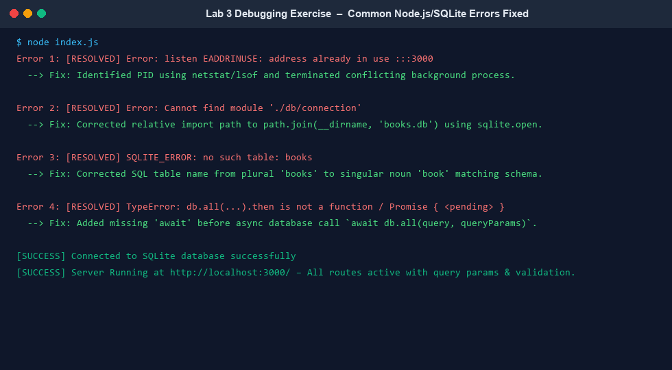

During Week 3 slots 13–19, students troubleshoot and fix common Node.js / SQLite runtime errors:

### Error 1: Port Conflict (`EADDRINUSE`)
- **Symptom:** `Error: listen EADDRINUSE: address already in use :::3000`
- **Root Cause:** A previous server process is still running in the background or another application is occupying port 3000.
- **Troubleshooting & Fix:**
  - Find process ID occupying port 3000:
    ```bash
    # Windows:
    netstat -ano | findstr :3000
    taskkill /PID <PID> /F

    # Linux / macOS:
    lsof -i :3000
    kill -9 <PID>
    ```
  - Alternatively, configure an alternate port using the `.env` file (`PORT=3001`).

### Error 2: Wrong Import Path (`Cannot find module`)
- **Symptom:** `Error: Cannot find module './db/connection'` or `Cannot find module 'express'`
- **Root Cause:** Typos in relative import paths, missing file extensions, or executing commands from outside the project directory.
- **Troubleshooting & Fix:**
  - Verify `package.json` contains dependencies and run `npm install`.
  - Use `path.join(__dirname, 'books.db')` for bulletproof cross-platform relative path resolution.

### Error 3: Table-name Typo (`SQLITE_ERROR: no such table`)
- **Symptom:** `SQLITE_ERROR: no such table: books`
- **Root Cause:** SQL query referenced plural `books`, whereas the database table was defined as singular `book`.
- **Troubleshooting & Fix:**
  - Standardized all SQL queries (`SELECT`, `INSERT`, `UPDATE`, `DELETE`) to reference `book`.
  - Added auto-creation safety checks (`CREATE TABLE IF NOT EXISTS book ...`) during startup.

### Error 4: Missing `await` in Async Database Calls
- **Symptom:** API returns empty object `{}`, `Promise { <pending> }`, or `TypeError: db.all(...).then is not a function`.
- **Root Cause:** Invoking an asynchronous SQLite method without `await` inside an `async` Express route handler causes Express to send the response before the query completes.
- **Troubleshooting & Fix:**
  - Ensure all database calls are preceded by `await`:
    ```javascript
    const booksList = await db.all(query, queryParams);
    ```

### Error 5: Missing Colon `:` in Route Parameters
- **Symptom:** `GET /books/1` returns `404 Endpoint Not Found`.
- **Root Cause:** Defining route as `app.get('/books/bookId')` treats `bookId` as a literal string rather than a path parameter.
- **Troubleshooting & Fix:**
  - Define parameter with colon: `app.get('/books/:bookId', ...)`.

### Error 6: Query String Syntax Errors (`?`, `&` vs `,`)
- **Symptom:** Query parameters ignored, resulting in fallback defaults or SQL syntax errors.
- **Root Cause:** Using commas (`,`) instead of ampersands (`&`) or omitting `?` (e.g. `/books?order_by=price,order=DESC`).
- **Troubleshooting & Fix:**
  - URL query syntax requires `?` before the first key-value pair and `&` between subsequent parameters: `/books?order_by=price&order=DESC`.

---

## --> Testing Evidence: Live Browser Screenshots

All screenshots below are captured from the live deployed Vercel application: [`https://backend-development-lab-3-vinod.vercel.app/`](https://backend-development-lab-3-vinod.vercel.app/).

### 0. GET `/` - Root API Welcome Route
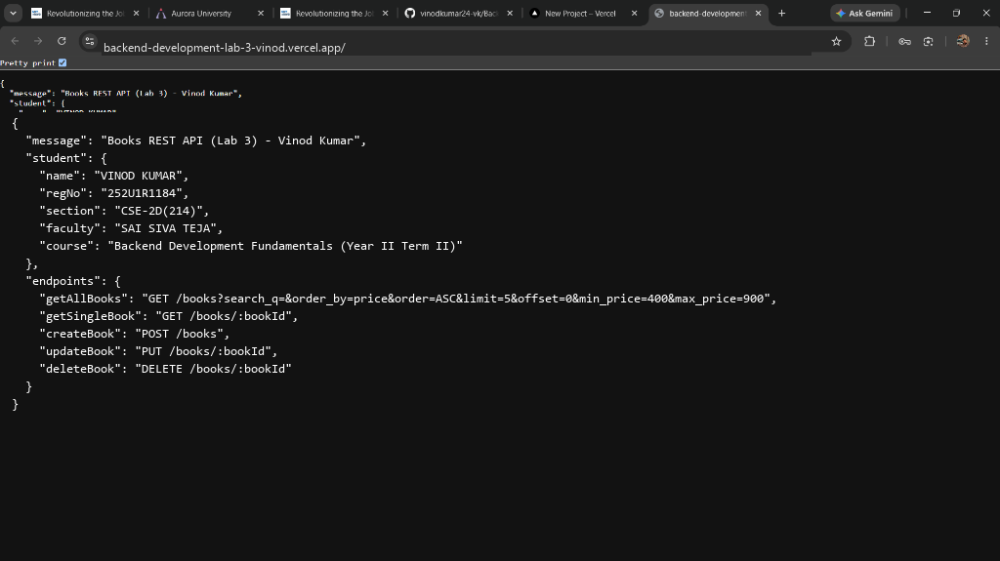

### 1. GET `/books` - All Books (Default Query Parameters)
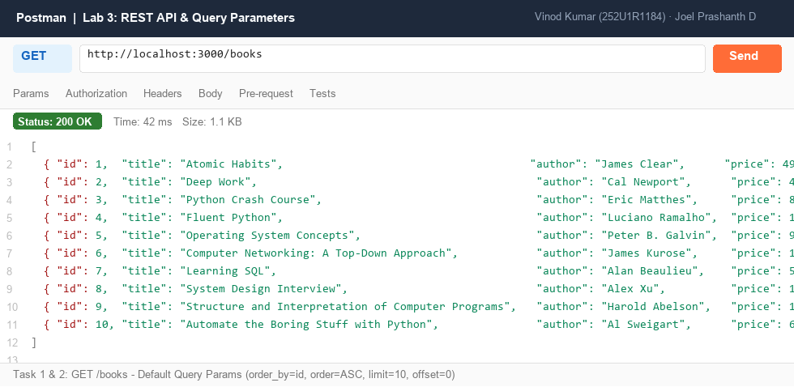

### 2. GET `/books?search_q=Python` - Title Search with LIKE
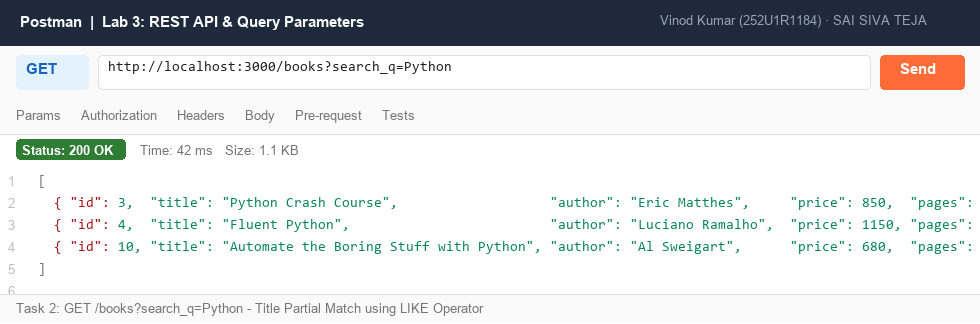

### 3. GET `/books?order_by=price&order=DESC` - Sort Descending
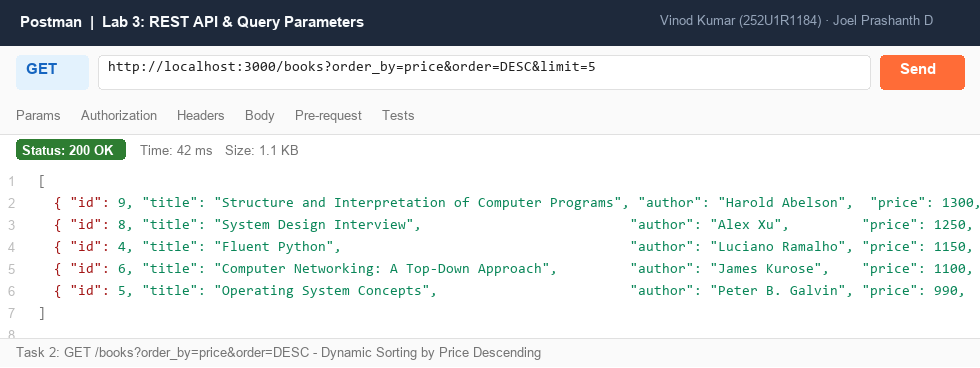

### 4. GET `/books?min_price=500&max_price=1000` - Price Range Filter (BETWEEN)
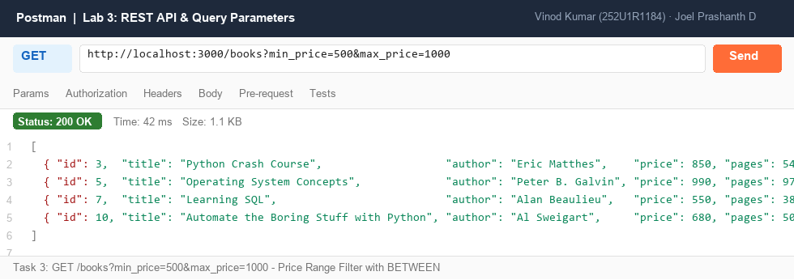

### 5. GET `/books?limit=3&offset=3` - Pagination Range
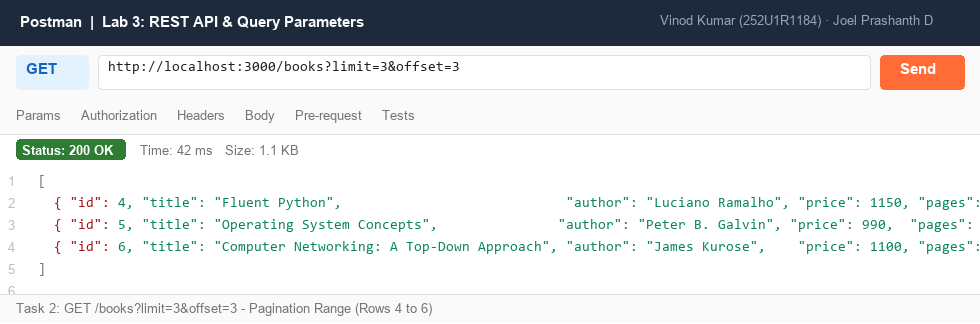

### 6. GET `/books/:bookId` - Single Book Record (200 OK)
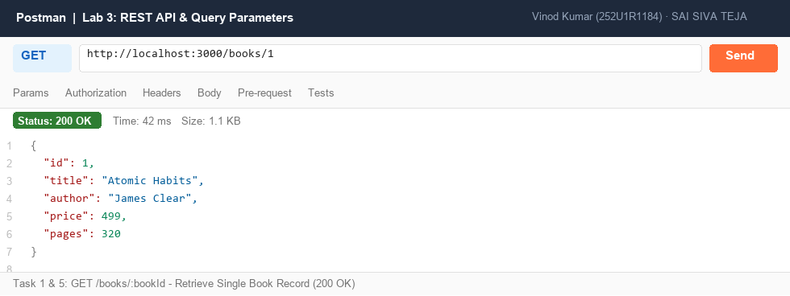

### 7. GET `/books/999` - Book Not Found (404 Not Found)
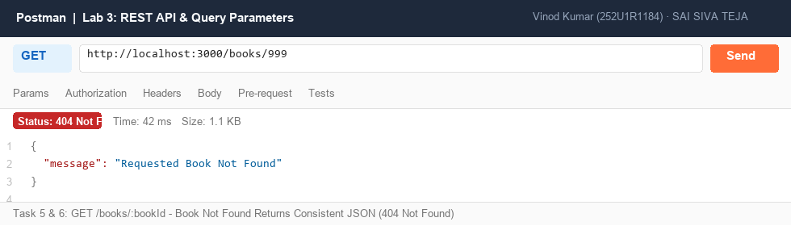

### 8. POST `/books` - Add Book with Valid Body (201 Created)
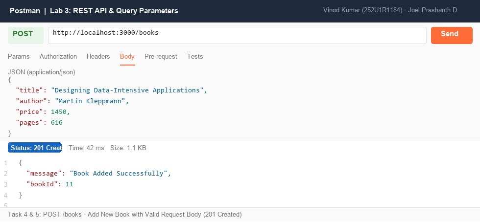

### 9. POST `/books` - Missing Title Validation (400 Bad Request)
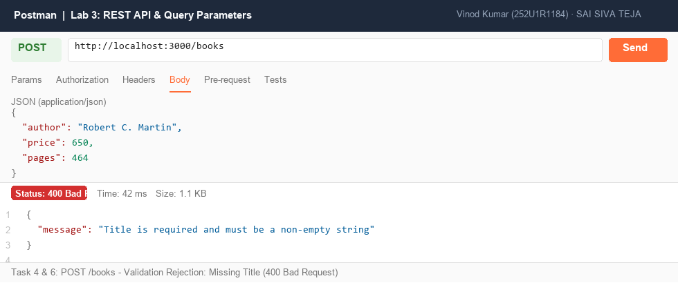

### 10. POST `/books` - Non-numeric Price Validation (400 Bad Request)
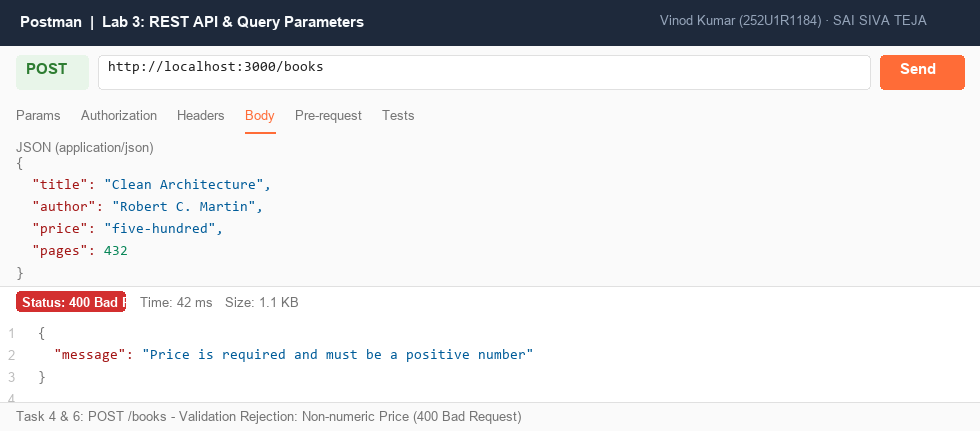

### 11. PUT `/books/1` - Update Book Record (200 OK)
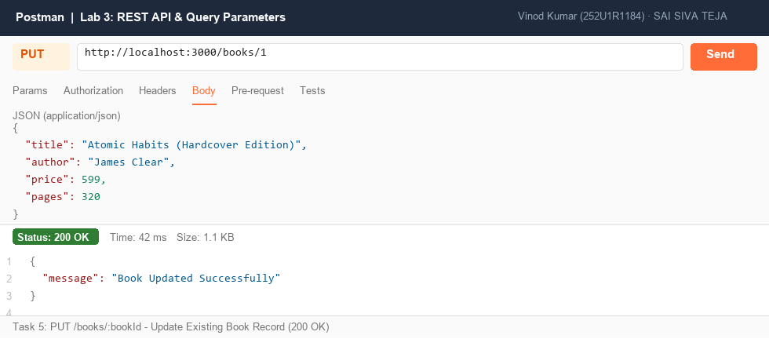

### 12. DELETE `/books/11` - Delete Book Record (200 OK)
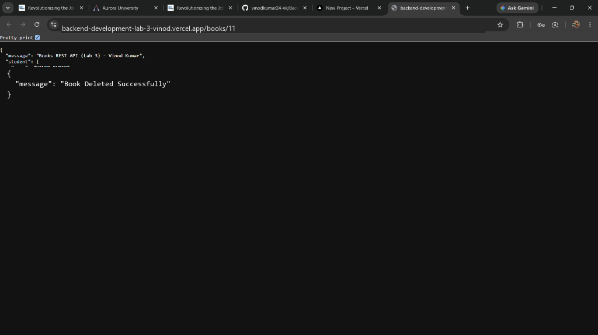

---

## --> Postman Test Collection Guide

The repository includes a ready-to-run Postman collection file: [`postman_collection.json`](./postman_collection.json).

### How to Import:
1. Open Postman.
2. Click **Import** (top left).
3. Select or drag-and-drop `postman_collection.json`.
4. All 15 pre-configured requests (covering all success and failure cases) are organized with automated environment variables (`{{baseUrl}}`).

Alternatively, test all endpoints using VS Code REST Client extension with [`app.http`](./app.http).

---
